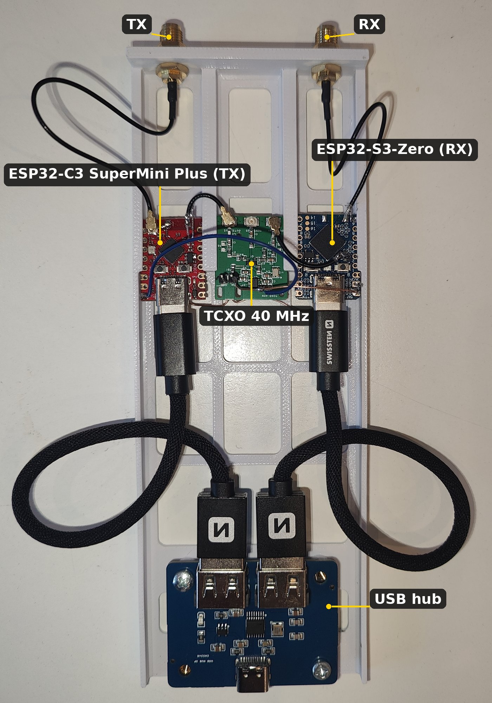

# ESP32 13 cm narrowband – CW / SSB on 2320 MHz with two ESP32 boards

A narrowband station for the 13 cm band (2320.0–2320.2 MHz, beacons at 2320.8–2321.0) built from two small
ESP32-C3 / ESP32-S3 boards (ESP32-C3 SuperMini Plus, Waveshare ESP32-S3-Zero) on one 40 MHz TCXO: the **ESP32-C3 transmits** (I/Q DAC driven by the CPU, the trick of SP8ESA), the
**ESP32-S3 receives** (raw I/Q over USB, ESP-SDR firmware). Control and DSP run in a web page on a PC, or on an Android
phone through a small USB bridge app. Companion of [ESP32-ATV](https://github.com/ok1cdj/ESP32-ATV) (DATV on the same
boards).

> **Status: experimental, work in progress.** It works on one bench (OK1CDJ). The measurements below are from that
> bench, not from a batch of boards. Expect to read the docs and to change things. Questions and reports are welcome.

> **For licensed radio amateurs.** Transmitting on 13 cm needs an amateur radio licence. Keep to the IARU Region 1
> band plan and your national rules: narrowband modes around 2320.0–2320.2 MHz, never transmit in the beacon segment
> (2320.8–2321.0 MHz) or on a beacon's frequency.

**Without a TCXO this does not work.** A stock C3 board (XIAO C3, own crystal) drifts about 6.5 kHz in the
first minute of transmitting and 300–450 Hz per 10 s over after that (measured,
[`docs/s3-trx/report.md`](docs/s3-trx/report.md), step 5). The crystal has to be replaced by an external 40 MHz TCXO, see [Hardware](#hardware).

## What works

- **CW beacon on the C3**: software NCO with a Hz-step offset from the LO, raised-cosine keying, Morse text + long carrier,
  settings in NVS. Received carrier −0.3 Hz from the set value, ±3 mHz over 10 s (TX and RX on the shared TCXO).
- **USB (SSB) transmit on the C3**: the host streams I/Q at 50 kS/s, the C3 interpolates to the DAC.
  Carrier −67 dBc, opposite sideband −69 dBc, IM3 −38 dBc at AMP 100 / −47 dBc at AMP 50.
- **Receiver on the S3**: gapless I/Q stream with loss detection (ESP-SDR `IQS`), spectrum, waterfall, CW and USB audio,
  presets for the Czech 13 cm beacons, DC (LO leakage) calibration of the C3 through the S3.
- **Over the air**: the beacon OK0EA (2320.804 MHz, JO70UP) received at 65 km with a 2 dBi Wi-Fi antenna.
- **Web page** [`web/`](web/README.md): RX + TX (microphone, WAV file, tones, PTT), Web Serial or a local bridge.
- **Android app** [`android/`](android/README.md): the same page on a phone, boards on a USB OTG hub.
- **Bench tools** [`tools/`](tools/): I/Q recording, CW analysis, tinySA Ultra+ measurements, SSB transmit from the
  command line.

C3 output at the U.FL connector: ≈ −37 dBm + 20·log(AMP), linear up to AMP 100 (≈ +2.5 dBm), at most ≈ +12.5 dBm.
Spurious: DAC images ±2 MHz −40 dBc, 2nd harmonic −46 dBc, LO leakage −21 dBc uncalibrated / −40…−46 dBc calibrated.

## Open issues

- A fixed spur at 2320.000 MHz (58 × 40 MHz, −34 dBc) while transmitting.
- DAC images at ±2 MHz need a filter or a faster DAC.
- Absolute frequency: only as good as the TCXO (±0.5 ppm ≈ ±1.2 kHz).
- GPS connection: not on the prototype yet. Plan: a GPS module (1 PPS + NMEA) on the S3, the S3 measures the shared
  TCXO against the PPS and the host corrects the frequency. The PPS capture was tried only on a plain XIAO S3
  (ESP-SDR fork, branch `s3-trx`).
- Phase noise not measured yet; OOK48 not started.
- The LO leakage calibration is lost at every C3 reset (the PHY calibrates anew at start): calibrate after power-up.

## Hardware

| Part | Status |
|---|---|
| ESP32-C3 SuperMini Plus (TX) and Waveshare ESP32-S3-Zero (RX), RF output to coax | in use |
| [**TCXO 40 MHz board**](hw/tcxo-40m/README.md), one TCXO for both boards (outputs to XTAL_P of the C3 and the S3, a −46 dB test tap) | **built and working** |
| [RX/TX antenna switch](hw/tr-switch/README.md) (HMC8038, interlock for the PA) | built, **not tested or measured yet** |
| PA, LNA | not designed |

Both boards come with Gerbers, BOM and pick & place for JLCPCB in `hw/*/vyroba/` (README in English and Czech,
the switch's design report in Czech).



The prototype: TX and RX SMA at the top, the two modules and the TCXO board, a USB hub at the bottom (the hub will be
published separately). Close-up: [`hw/tcxo-40m`](hw/tcxo-40m/README.md#the-modules-esp32-c3-supermini-plus-esp32-s3-zero).

Converting a board to the TCXO means removing its crystal and the load capacitors and feeding the TCXO to the XTAL_P
pin through a U.FL pigtail. These two boards are used because they have no shield can over the crystal (the XIAO
have one; XIAO boards served only for the plain-crystal and GPS tests). It is fine work on a small module; do it
only if you can. A detailed step-by-step description will follow.

Sharing one TCXO between TX and RX makes them coherent: the frequency difference between them is only the PLL rounding,
which the software computes, so the received beacon sits on the exact Hz.

## Firmware

Both are forks kept in their own repositories; this repository holds no firmware source.

| Board | Firmware | Licence |
|---|---|---|
| C3 (TX) | [ok1cdj/ESP32-DATV-SA](https://github.com/ok1cdj/ESP32-DATV-SA), branch `cw-beacon` (fork of SP8ESA's ESP32-DATV-SA); build with [`tools/build_c3_cw.sh`](tools/build_c3_cw.sh) | PolyForm Noncommercial 1.0.0 |
| S3 (RX) | [zodoczi/esp-sdr](https://github.com/zodoczi/esp-sdr), release `s3-fw-2026.10.08b` | GPL-3.0-or-later |

The C3 firmware is **non-commercial only** (licence of the original by SP8ESA).

## Quick start

Python 3 with `pyserial` and `websockets` (the bridge); `numpy` and `matplotlib` for the analysis tools. Port defaults are in [`tools/nbports.py`](tools/nbports.py);
set your own through the environment:

```sh
export TX_PORT=/dev/serial/by-id/usb-Espressif_USB_JTAG_serial_debug_unit_<C3 MAC>-if00
export RX_PORT=/dev/serial/by-id/usb-Espressif_USB_JTAG_serial_debug_unit_<S3 MAC>-if00
tools/nb_rx.sh            # bridge + browser on http://localhost:8080
```

`http://localhost:8080/?demo` runs the page without boards. Details in [`web/README.md`](web/README.md).

## Documentation (Czech)

| File | Content |
|---|---|
| [`docs/nb-cw-ssb-13cm.md`](docs/nb-cw-ssb-13cm.md) | plan: why the TCXO, modes, RF path, steps |
| [`docs/nb-cw-krok1.md`](docs/nb-cw-krok1.md) | step 1: CW beacon on the C3, spectrum, reception on the S3 |
| [`docs/nb-s3-trx-report.md`](docs/nb-s3-trx-report.md) | survey: one ESP32-S3 as TX and RX |
| [`docs/s3-trx/report.md`](docs/s3-trx/report.md) | single-board S3 experiments, LO leakage vs temperature, plain-crystal drift, decision to stay with the TCXO; measured data in `docs/s3-trx/*.csv` |

## Licence

Software and docs: GPL-3.0 ([`LICENSE`](LICENSE)). Hardware in `hw/`: CERN-OHL-S-2.0 ([`hw/LICENSE`](hw/LICENSE)).
`android/.../UsbCdc.kt` comes from ESP32-ATV (GPL-3.0). The firmware forks above keep
their own licences.

73 de OK1CDJ
