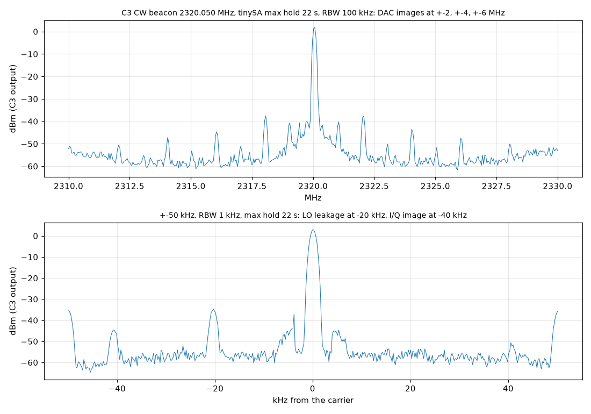
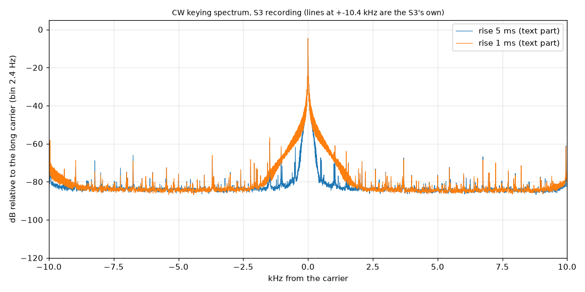
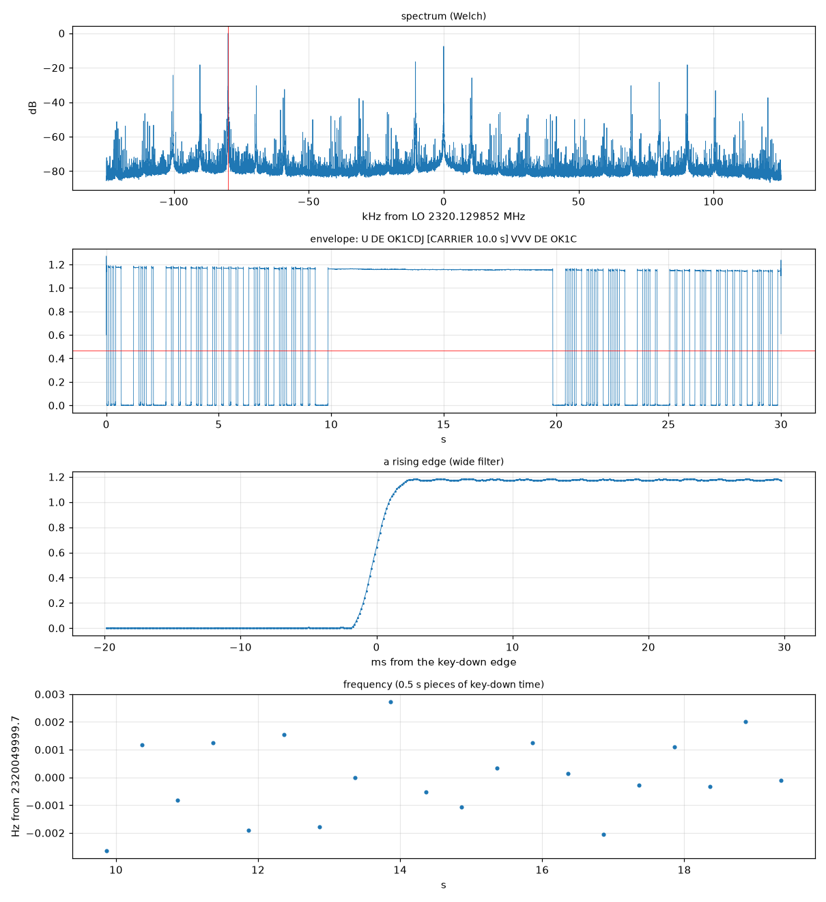

# NB krok 1 – CW maják na C3 s TCXO, spektrum a příjem na S3

9. 11. 2026 · zadání: [`zadani-cw-krok1.md`](zadani-cw-krok1.md) · plán: [`nb-cw-ssb-13cm.md`](nb-cw-ssb-13cm.md)

**Výsledek:** C3 vysílá CW maják (Morse text + dlouhá nosná) z NCO s offsetem od LO a tvarovaným klíčováním,
S3 ho přijímá a `tools/cw_analyze.py` z nahraného I/Q dekóduje text:

```
decoded: U DE OK1CDJ [CARRIER 10.0 s] VVV DE OK1C        (U = useknuté V na začátku záznamu)
```

Kmitočet nosné vůči nastavené hodnotě −0,3 Hz (C3 a S3 na společném TCXO), ±3 mHz během 10 s nosné.

---

## 1. Zapojení

```
deska TCXO 40 MHz ──J1──> XTAL_P XIAO ESP32-C3 (7C:4F:AD:D1:B4:0C) ──U.FL──> útlum 30 dB ──> tinySA Ultra+ ZS-407
                  ──J2──> XTAL_P XIAO ESP32-S3 (A0:F2:62:EA:C5:70), keramická anténa (příjem jen přeslechem)
                  ──J3──  testovací odbočka −46 dB (měření TCXO přímo tinySA)
všechno přes jeden USB hub PC
```

- Jedno TCXO pro C3 i S3: rozdíl kmitočtů TX–RX je jen zaokrouhlení PLL; absolutní chybu TCXO tak změřit nejde.
- Porty jsou v [`tools/nbports.py`](../tools/nbports.py) (přepsatelné proměnnými `TX_PORT`, `RX_PORT`, `SA_PORT`).

## 2. Firmware C3 (CW maják)

Fork ESP32-DATV-SA (PolyForm Noncommercial) – **lokální klon `fw/ESP32-DATV-SA`, větev `cw-beacon`** (z `xiao-panel`),
v tomto repu jen v `.gitignore`. Build bez vestavěného DVB-S2 testovacího obrazu – po nahrání C3 sama nic nevysílá:

```sh
. ~/esp/esp-idf-v6.1/export.sh
tools/build_c3_cw.sh -                                     # jen build
tools/build_c3_cw.sh /dev/serial/by-id/usb-Espressif_USB_JTAG_serial_debug_unit_7C:4F:AD:D1:B4:0C-if00   # build + flash
```

**Jak to funguje:** NCO (32bit fázový akumulátor, tabulky sin/cos 4096 bodů, Q13) na offsetu od LO; DAC 2 MS/s ze smyčky
v C (časování cyklovým čítačem, přerušení vypnutá, jako DVB-S2 maják). PLL bere jen celé kHz a krokuje po 457,8 Hz –
NCO dopočítá zbytek, takže výsledný kmitočet sedí na Hz. Obálka raised cosine, krok po 16 vzorcích (8 µs), náběh od
stisku klíče, doběh od puštění (50% body drží délku značky). Uplatní se DC korekce (`BDC`, tabulka podle kmitočtu LO)
a I/Q korekce majáku. Smyčka běží z flash cache (IRAM je plná až k RF bance); pozdní vzorky ~0,1 %.

**Příkazy** (USB, řádek s `\n`):

| Příkaz | Význam |
|---|---|
| `CW` / `CW INFO` | výpis nastavení (je i v `INFO`) |
| `CW ON` / `CW OFF` | CW maják místo DVB-S2 / vypnout (vysílač zůstane vypnutý) |
| `CW SET F 2320.05` | kmitočet nosné [MHz] |
| `CW SET NCO 20000` | nosná − LO [Hz], 0 povoleno |
| `CW SET AMP 100` | amplituda [DAC kódy 1..480] |
| `CW SET WPM 15`, `TEXT VVV DE OK1CDJ` | rychlost, text (≤ 64 znaků) |
| `CW SET CARRIER 10`, `RISE 5` | dlouhá nosná [s], náběh/doběh [ms 0,5..20] |
| `CW SET PA 0`, `AUTO 1` | PA (GPIO3), CW maják po zapnutí |
| `CW SAVE` / `CW DEFAULTS` | uložit do NVS (`cw`/`cfg`) / výchozí hodnoty |

Jakýkoli bajt z USB maják zastaví (jako u DVB-S2); `CW` příkazy ho při `CW ON 1` zase spustí. `CW SET` maják nezapíná.
Výchozí: 2320,050 MHz, NCO +20 kHz, AMP 100, 15 WPM, `VVV DE OK1CDJ`, nosná 10 s, náběh 5 ms, PA 0, AUTO 0.
DVB-S2 maják beze změny. Generátor klíčování a tabulky ověřuje `host/test_cw.c` (ve forku).

## 3. Nástroje (tento repozitář, GPL)

```sh
tools/sa_capture.py sweep --center 2320.05e6 --span 100e3 --rbw 1 --ext-att 30 --maxhold 20 -o build/meas/x   # CSV + PNG
tools/sa_capture.py drift --center 40e6 --span 1e3 --interval 5 --duration 300 -o build/meas/tcxo
tools/sa_capture.py pn --center 2320.0514e6 --ext-att 30 -o build/meas/pn
tools/rx_record.py build/rx/cw --signal 2320.05e6 --seconds 30        # S3: cf32 + JSON (skutečný LO)
tools/cw_analyze.py build/rx/cw --plot build/rx/cw                     # kmitočet, drift, SNR, hrany, dekódovaný text
tools/cw_analyze.py --selftest
```

Poslech bez SDR++ zatím není – příjem jen záznamem a analýzou (SDR++ není nainstalované; případně GQRX/SDRangel přes
`rx/spectrum.sh` z ESP32-ATV, rtl_tcp 127.0.0.1:1234).

Poznatky k nástrojům:

- **tinySA:** po připojení někdy neodpovídá, dokud se na přístroji nezavře menu / nezkontroluje CONFIG → CONNECTION = USB.
  Nad 800 MHz je nutný ultra režim (`sa_capture.py` ho zapíná). `scanraw` čte kmitočet o ~220 Hz výš (40 MHz) – kmitočty
  se berou z normálního sweepu (`data 2` + `frequencies`). Vlastní TCXO tinySA ~0,5–1 ppm, bez ext. reference.
- **S3 (espdr):** při 333 ksps přes sdílený hub S3 zahodila 8 % jednotek → skoky fáze, rozbité dekódování;
  **250 ksps je výchozí**. LO S3 80 kHz nad signálem (hrb ±25 kHz kolem LO, spur S3 na 2320,000 MHz mimo pásmo).
- **Artefakty S3:** se silným tónem vidí S3 čáry souměrné kolem svého LO (zrcadlo I/Q ~−28 dB, produkty ±10,4 kHz,
  −18 až −30 dB). Na výstupu C3 (tinySA) nejsou (≤ −56 dBc) → jsou to artefakty přijímače. S vypnutou C3 má S3 jen DC
  a čáru na +120 kHz (−42 dB).

## 4. Měření

### TCXO 40 MHz (J3, tinySA)

| | |
|---|---|
| kmitočet | 40 000 013 Hz (+0,33 ppm vůči tinySA – v rámci přesnosti tinySA) |
| krátkodobě (2 min, á 5 s) | p-p 1,2 Hz, std 0,3 Hz |
| úroveň na J3 | −38,4 dBm → na emitoru ~1,5 Vpp (README desky čekalo 0,7–1,1 Vpp; XTAL_P max 1,1 V – ověřit osciloskopem, obě desky ale běží) |
| harmonické (J3) | 2. a 3. ~−17 dBc, 4. ~−30 dBc |
| fázový šum | na 40 MHz nad možnosti tinySA (měřeno = dno přístroje: −87 dBc/Hz @1 kHz, −98 @10 kHz) |

Na 40 MHz (napájení z mobilu) byly kolem nosné čáry −55…−62 dBc (±4–5 kHz, +13 kHz, skupina u +300 kHz). Na 2320 MHz
(×58, tj. +35 dB, napájení z hubu PC) **žádné odpovídající čáry nejsou** – nebyla to fázová modulace reference.
Srovnání obou zdrojů na 2320 MHz zatím nebylo.

### Nosná C3 na 2320 MHz (tinySA, útlum 30 dB přičten)

| | |
|---|---|
| únik LO samotný (`BDC TEST`, DC 0/0) | ~−30 dBm, kmitočet +1459 Hz vůči LO podle firmwaru (+0,63 ppm vůči tinySA) |
| CW nosná, AMP 100 | **+3 dBm**, 2 320 051 399 Hz podle tinySA (stejný posun reference tinySA ~+0,6 ppm) |
| krátkodobá stabilita (tinySA, 60 s) | p-p 51 Hz = šum měření tinySA; ze S3: **±3 mHz za 10 s, −0,3 Hz od nastavení** |
| únik LO (−20 kHz) | −38 dBc bez korekce; −37,5 dBc v CW i po kalibraci (viz níže) |
| zrcadlo I/Q (−40 kHz) | −48,5 dBc (bez I/Q korekce) |
| obrazy DAC | ±2,004 MHz −39/−40 dBc, ±4 MHz −45/−46, ±6 MHz −49; −1,024 MHz −42 dBc (původ nejasný) |
| 2. harmonická 4640,10 MHz | **−46 dBc** (stejně při útlumu tinySA 0 i 10 dB → skutečná) |
| vypnutá C3 (`CW OFF`) | LO dál běží: na RF výstupu −78,6 dBm (~−81 dBc), deska ho ale vyzařuje – S3 přeslechem vidí silnou čáru |
| fázový šum (tinySA, horní mez) | −63 dBc/Hz @1 kHz, −75 @10 kHz, −82 @100 kHz, −87 @1 MHz |

**Kalibrace DC** (`BDC TEST on 2320.03`, hledání minima tinySA): `BDC 2320030 −3,52 1,00` uloženo do tabulky v NVS.
Samotný únik klesl z −21…−31 dBm na −40…−45 dBm. **V režimu CW se ale únik nezlepšil (−37,5 dBc)** – s plnou nosnou
vzniká další DC složka (nelinearita), kalibrovat by se mělo s běžící nosnou. Pro CW to nevadí (únik je 20 kHz vedle).



### Klíčování (S3, koherentní záznam)

| | rampa 5 ms | rampa 1 ms |
|---|---|---|
| hrany 10–90 % (teorie 0,59·T) | 2,63 ms (2,95) | 0,63 ms (0,59) |
| spektrum textu @200 Hz | −51 dBc | −44 dBc |
| @300 Hz | −60 dBc | −48 dBc |
| @500 Hz | −62 dBc | −53 dBc |
| ≥ 1 kHz | −61…−75 dBc | stejně (dno měření) |

(dBc v binu 2,4 Hz vůči dlouhé nosné.) 5 ms je o 7–12 dB čistší v 200–500 Hz; dál dno měřicí cesty (šum, fázový šum
dvou PLL, artefakty S3), tinySA blízko nosné nestačí (−31 dBc @1 kHz).



### Příjem na S3

Záznam 30 s, 250 ksps, LO S3 2 320 129 852 Hz: tón 2 320 049 999,7 Hz, SNR 30 dB v 500 Hz (přeslech), dit 80,0 ms
= 15,0 WPM, nosná 10,0 s, text dekódován celý.



## 5. Otevřené body

1. **Obrazy DAC −40 dBc na ±2 MHz:** pipe-cap je neodfiltruje. Vyšší rychlost DAC (4 MS/s → ~−46 dBc na ±4 MHz,
   8 MS/s jen v asm) nebo interpolace; případně úzká propust.
2. **DC kalibrace s běžící nosnou** (CW) a I/Q korekce zrcadla (dnes jen v době kompilace `BEACON_IQ_GAIN/PHASE`).
3. **Fázový šum** blízko nosné: tinySA nestačí; S3 vidí součet dvou PLL. Rigol (RBW 1 Hz) nebo nezávislý přijímač.
4. **Absolutní kmitočet:** potřeba reference (GPS/PPS, krok 4 plánu).
5. Amplituda TCXO na XTAL_P (osciloskop), srovnání napájení mobil × PC na 2320 MHz.
6. Firmware: `INFO` ukazuje verzi z `git describe` forku (opraveno v `build_c3_cw.sh`); CW smyčka v IRAM by snížila pozdní vzorky, ale IRAM je plná.
