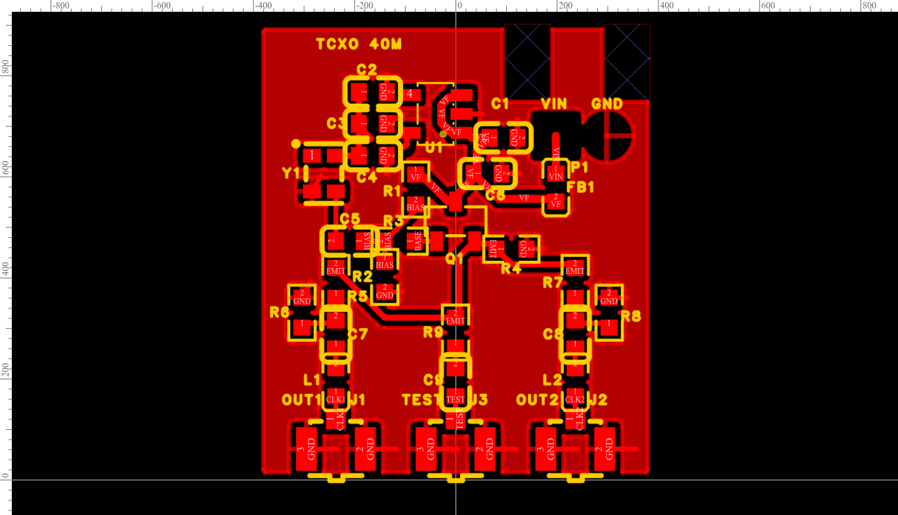
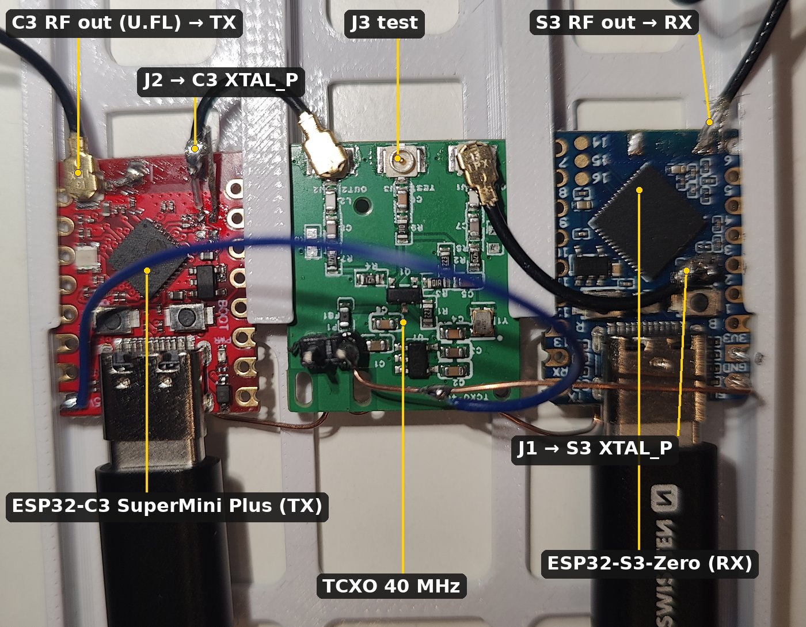

# TCXO 40 MHz pro ESP32-C3 / S3 (2 výstupy)

[English](README.md) · česky

Malá deska s TCXO 40,000 MHz jako náhrada krystalu na **dvou** modulech ESP32. Napájení z vlastního vstupu 5–5,5 V,
nízkošumové LDO napájí jen TCXO. Signál z TCXO odděluje emitorový sledovač (2SC3356) a rozděluje ho do dvou
výstupů U.FL. Každý vede U.FL pigtailem na pad XTAL_P jednoho modulu po sundání krystalu. Třetí U.FL je
testovací odbočka pro spektrální analyzátor.

| | |
|---|---|
| deska | 20 × 23 mm, 2 vrstvy, 1,6 mm, rohy R0,5, vše osazené na TOP, GND rozlitá na obou vrstvách |
| napájení | pájecí plošky P1 vpravo nahoře: **VIN** (čtverec), **GND**; nad nimi 2 výřezy 1,3 × 2,8 mm pro stahovací pásku |
| výstupy | dole zleva: **J1 OUT1**, **J3 TEST**, **J2 OUT2** (U.FL Hirose, C88374) |
| stav | **postavená a funkční**: od 9. 11. 2026 taktuje ESP32-C3 SuperMini Plus (TX) a Waveshare ESP32-S3-Zero (RX) zároveň |



## Zapojení

```
P1 VIN 5–5,5 V ──[FB1]── VF ──┬── U1 LP5907-3.3 IN, EN ── OUT ── V_TCXO ──┬──────┬──────┬── Y1.4 VDD
                              C1 1µ                                      C2 1µ  C3 100n C4 10n (u pinu)

Y1.3 OUT ──[C5 10n]── BIAS ──[R3 100R]── BASE ── Q1 2SC3356 B        Q1 C ── VF (C6 100n)
                        │                                             Q1 E ── EMIT ──[R4 470R]── GND  (≈ 3 mA)
                VF ─[R1 22k]─┤
                        └─[R2 22k]─ GND

EMIT ──[R5 47R]── OUT1_A ──[C7 47p C0G]── OUT1_C ──[L1 24nH]── CLK1 ► J1 U.FL ─ pigtail ─► XTAL_P modul #1
                    └─[R6 DNP]─ GND
EMIT ──[R7 47R]── OUT2_A ──[C8 47p C0G]── OUT2_C ──[L2 24nH]── CLK2 ► J2 U.FL ─ pigtail ─► XTAL_P modul #2
                    └─[R8 DNP]─ GND
EMIT ──[R9 10k]── TEST_A ──[C9 10n]── TEST ► J3 U.FL ─► SMA ─► analyzátor 50 Ω   (≈ −46 dB, bez DC)

Y1.1 = NC (podle datasheetu YXC se nesmí nikam připojit), Y1.2 = GND.
```

Schéma z EasyEDA: [`vyroba/TCXO-40M_schema.png`](vyroba/TCXO-40M_schema.png).

### Proč sledovač

TCXO (clipped sine, min. 0,8 Vpp) je specifikované na zátěž 10 kΩ ∥ 10 pF. Na 40 MHz je to hlavně 10 pF,
tedy ≈ 400 Ω. Každá větev k modulu (47 pF v sérii s koaxem, vstupem ESP a případným zbylým zatěžovacím
kondenzátorem krystalu) má kolem 10–20 pF. Dvě větve přímo na TCXO by ho přetížily a amplituda by spadla
k hranici 500 mV.

Sledovač má na vstupu ≈ 5 kΩ ∥ pár pF (R1 ∥ R2 a β · zátěž emitoru), TCXO je tedy zatížené méně než ve
specifikaci. Výstupy má nízkoimpedanční a navzájem oddělené.

- **2SC3356 (ft 7 GHz)**, ne MMBT3904: ten má na 40 MHz proudový zisk jen ≈ ft/f ≈ 7, takže by vstup
  sledovače spadl na ≈ 1,5 kΩ.
- **R3 100 Ω v bázi a R5/R7 47 Ω na výstupech** brání rozkmitání rychlého tranzistoru s kapacitní zátěží.
  Zároveň tlumí sériovou rezonanci 24 nH s kapacitou koaxu (≈ 300 MHz).
- **Pracovní bod:** báze ≈ 1,9–2,3 V z děliče 22k/22k, emitor ≈ 1,3–1,7 V, I_E ≈ 2,7–3,6 mA (hFE 50–250).
  Sledovač bere proud z VF (5 V za feritem), ne z LDO. Napájení TCXO tak zůstává čisté.

| ref | LCSC | díl | pozn. |
|---|---|---|---|
| Y1 | C22434887 | YXC OW7EL89CENUYO3YLC-40M, 2016, 3,3 V, clipped sine, ±1,5 ppm | ≥ 0,8 Vpp, 3,5 mA |
| U1 | C80670 | TI LP5907MFX-3.3, SOT-23-5 | 6,5 µVrms, Vin max 5,5 V, EN = IN |
| Q1 | C2910157 | CJ 2SC3356, SOT-23 (1 B, 2 E, 3 C) | ft 7 GHz, hFE 50–250 |
| FB1 | C1002 | Sunlord GZ1608D601TF, 600 Ω @100 MHz | |
| C1, C2 | C15849 | 1 µF 0603 | |
| C3, C6 | C14663 | 100 nF 0603 | C3 u VDD Y1, C6 u kolektoru Q1 |
| C4, C5, C9 | C57112 | 10 nF 0603 | C4 nejblíž VDD Y1, C5 vazba do báze, C9 oddělení testu |
| C7, C8 | C1671 | 47 pF C0G 0603 | oddělovací kondenzátor na XTAL_P |
| L1, L2 | C74305 | Sunlord SDCL1608C24NJTDF, 24 nH 0603 | sériová cívka na XTAL_P (Espressif), lze nahradit 0 Ω |
| R1, R2 | C31850 | 22 kΩ 0603 | dělič báze |
| R3 | C22775 | 100 Ω 0603 | do báze (proti oscilacím) |
| R4 | C23179 | 470 Ω 0603 | emitorový odpor |
| R5, R7 | C23182 | 47 Ω 0603 | sériová část děliče výstupu, oddělení výstupů |
| R6, R8 | C25804 | 10 kΩ 0603, **DNP** | paralelní část děliče, osadit jen při ladění |
| R9 | C25804 | 10 kΩ 0603 | testovací odbočka |
| J1, J2, J3 | C88374 | Hirose U.FL-R-SMT-1(80) | OUT1, OUT2, TEST |
| P1 | – | pájecí plošky 1×2 | žádný díl, mimo BOM |

## Co říká Espressif (hardware design guidelines)

- **C3 a S3:** checklisty popisují jen krystal: 40 MHz, ±10 ppm, amplituda **> 500 mV**, na XTAL_P
  sériová cívka **24 nH** proti harmonickým (hodnota se má doladit podle RF testu). Externí oscilátor tam
  výslovně popsaný není.
- **ESP32-S2 checklist** (nejbližší, kde je to výslovně uvedené): *„If an oscillator is used, its output
  should be connected to XTAL_P on the chip through a DC blocking capacitor (about 50 pF). XTAL_N can be
  floating.“* Odtud C7/C8 = 47 pF. XTAL_N na modulu nechat volný.
- Horní mez 1,1 V na XTAL_P v guidelines není. Je to vlastní cílová hodnota.

## Amplituda na XTAL_P

Sledovač má zisk ≈ 0,9, na EMIT tedy bude ≈ 0,7–1,1 Vpp. C7 (47 pF) pak tvoří s kapacitou na straně modulu
kapacitní dělič 47 / (47 + C_modul). Do C_modul patří koax (≈ 1 pF/cm), vstup ESP a **zatěžovací kondenzátor
krystalu na XTAL_P, pokud na modulu zůstane** (typ. 10–12 pF).

| C_modul | dělení | XTAL_P při 0,8 Vpp z TCXO |
|---|---|---|
| 8 pF (zatěžovací C sundaný, krátký koax) | 0,85 | ≈ 0,61 Vpp |
| 20 pF (zatěžovací C ponechaný) | 0,70 | ≈ 0,50 Vpp |

Spodní hranice 500 mV je tedy blízko. Doporučení: **sundej i zatěžovací kondenzátor na XTAL_P** (ten na XTAL_N
může zůstat) a změř sondou 10× přímo na XTAL_P.

- Málo signálu: C7/C8 → 100 pF (C0G), dělení pak 0,83–0,93.
- Moc signálu (nad 1,1 V): osaď dělič R5/R6 (R7/R8), například R5 = 100 Ω a R6 = 220 Ω, to dá ≈ 0,7.

## Testovací výstup (J3)

R9 10 kΩ do 50 Ω vstupu dává útlum ≈ **46 dB** (20·log(10050/50)). C9 drží DC emitoru (≈ 1,3–1,7 V) mimo
analyzátor. Úroveň na EMIT ≈ 200 × Vpp na 50 Ω, čekej asi −40 až −45 dBm. Frekvenci a harmonické změříš
přímo, a protože J3 visí na stejném uzlu jako oba výstupy, měřit jde i za provozu. Amplitudu na XTAL_P
ale měř sondou přímo na padu.

## K modulu (ESP32-C3 SuperMini Plus, ESP32-S3-Zero)



Prototyp: J2 taktuje C3, J1 taktuje S3 (oba výstupy jsou stejné), J3 je volný. RF výstup každého modulu vede pigtailem
na SMA: C3 má vlastní U.FL, u S3 je koax připájený na pad antény. Celý prototyp s USB hubem (ten se zveřejní zvlášť):
[`foto/prototype.jpg`](foto/prototype.jpg).

> Podrobný postup úpravy bude doplněn.

- Použité jsou **ESP32-C3 SuperMini Plus** (z e-shopu, výrobce neuveden) a **Waveshare ESP32-S3-Zero**: nemají stínicí
  kryt, krystal je přístupný. **XIAO** ho mají pod krytem, který by se musel sundat horkým vzduchem; na XIAO se dělal
  jen test, jestli jde obyčejný krystal stabilizovat z GPS (nejde, viz `docs/s3-trx/report.md`).
- Krystal sundej i **oba zatěžovací kondenzátory** (na postaveném kusu jsou pryč u obou modulů). Pigtail U.FL 1,13 mm
  s odstřiženým koncem: živý vodič na pad XTAL_P, stínění na GND pad krystalu, co nejkratší odizolovaný konec. Koax
  přichyť k desce modulu (kapka lepidla nebo kaptonu).
- GND každého modulu spoj s deskou i silnějším vodičem (např. na GND plošku P1 nebo GND u U.FL), ať zpětný
  proud nejde jen stíněním koaxu.
- VIN 5–5,5 V **nesmí přesáhnout 5,5 V** (max. LP5907). Z USB 5 V je to v pořádku. Odběr ≈ 10 mA.

## Ověřeno na stole (9. 11. 2026)

Jedna deska, J2 → XTAL_P ESP32-C3 SuperMini Plus, J1 → XTAL_P ESP32-S3-Zero (jako na fotce), J3 → tinySA Ultra+.
Podrobnosti: [`../../docs/nb-cw-krok1.md`](../../docs/nb-cw-krok1.md), kap. 4.

| | |
|---|---|
| kmitočet | 40 000 013 Hz (+0,33 ppm vůči tinySA, v rámci jeho přesnosti) |
| krátkodobě (2 min, á 5 s) | p-p 1,2 Hz, std 0,3 Hz |
| úroveň na J3 | −38,4 dBm → na emitoru ~1,5 Vpp, víc než odhad výše; amplitudu přímo na XTAL_P zatím nikdo neměřil osciloskopem, oba moduly běží |
| harmonické (J3) | 2. a 3. ~−17 dBc, 4. ~−30 dBc |
| CW nosná na 2320 MHz, TX i RX z této desky | −0,3 Hz od nastavené hodnoty, ±3 mHz během 10 s |

Vyrobený a ověřený je zatím jeden kus. Úprava modulu (sundání krystalu a kondenzátorů, napojení koaxu) je nejtěžší část
celé stavby.

## Data pro výrobu: `vyroba/`

| soubor | k čemu |
|---|---|
| `TCXO-40M_Gerber.zip` | Gerber + vrtání, nahrát do JLCPCB (výřezy jsou v obrysové vrstvě) |
| `TCXO-40M_BOM_JLC.csv` | BOM pro JLC osazení (25 SMD dílů, R6/R8 vynechané jako DNP) |
| `TCXO-40M_CPL_JLC.csv` | pick & place pro JLC osazení |
| `TCXO-40M_BOM_full.csv` | úplný BOM včetně R6/R8 (DNP) |
| `TCXO-40M_top.png`, `_bottom.png` | náhled desky z EasyEDA (shora, zespodu) |
| `TCXO-40M_schema.png` | schéma |

**Objednávka:** 2 vrstvy, 1,6 mm, HASL lead-free, standardní pravidla. Osazení TOP.

### Před objednáním ověř

1. **Sklad** v JLC v den objednání. LCSC 2026-10-19: Y1 C22434887 624 ks, Q1 C2910157 930 ks. Dál C74305,
   C1002, C88374, C23182.
2. **Natočení** Y1 (pin 1 = NC), U1, Q1 a J1–J3 v DFM náhledu JLC.
3. Na hotovém kusu nejdřív bez modulů:
   - VF ≈ 5 V, V_TCXO 3,3 V, EMIT ≈ 1,3–1,7 V DC;
   - na J3 40,000 MHz bez parazitních čar nad 100 MHz (oscilace sledovače);
   - harmonické.

Navrženo v EasyEDA Pro (projekt `TCXO-40M`). Zdrojový projekt EasyEDA ani skripty, které ho generovaly, tu nejsou.

Licence: CERN-OHL-S-2.0 ([`../LICENSE`](../LICENSE)).
