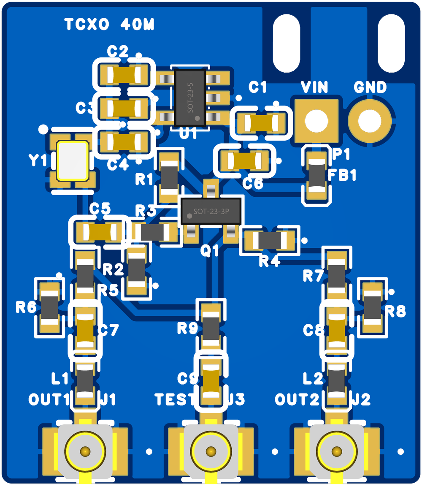
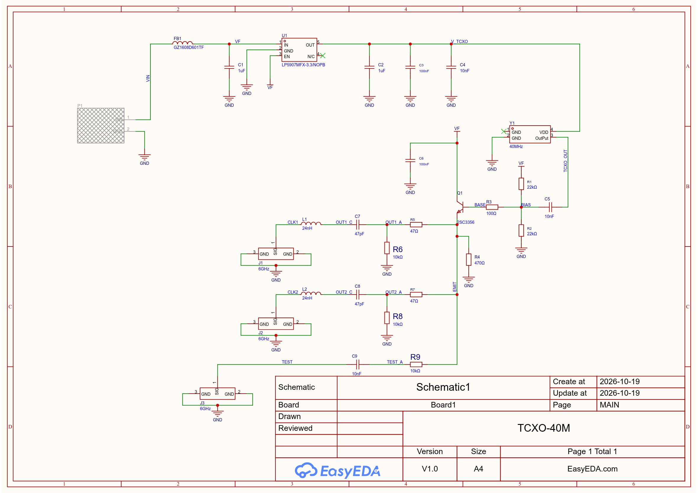
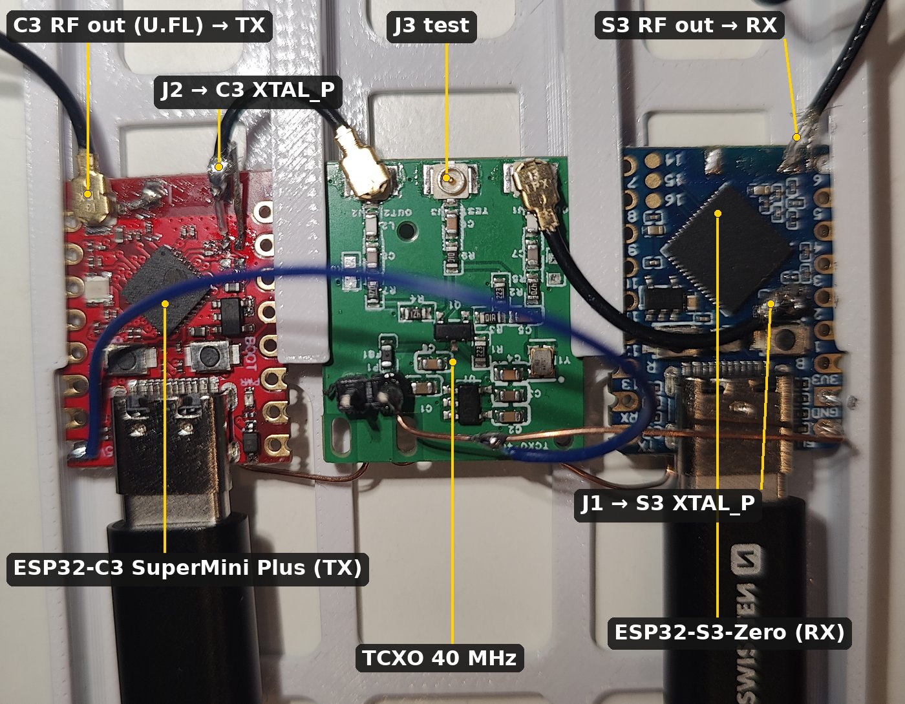

# TCXO 40 MHz for ESP32-C3 / S3 (2 outputs)

English · [česky](README.cs.md)

A small board with a 40.000 MHz TCXO that replaces the crystal on **two** ESP32 modules. It has its own 5–5.5 V input;
a low-noise LDO feeds only the TCXO. An emitter follower (2SC3356) buffers the TCXO and splits it into two U.FL outputs.
Each goes through a U.FL pigtail to the XTAL_P pad of one module, its crystal removed. A third U.FL is a test tap for a
spectrum analyser.

| | |
|---|---|
| board | 20 × 23 mm, 2 layers, 1.6 mm, corners R0.5, all parts on TOP, GND pour on both layers |
| power | solder pads P1 top right: **VIN** (square), **GND**; above them 2 slots 1.3 × 2.8 mm for a cable tie |
| outputs | bottom, from the left: **J1 OUT1**, **J3 TEST**, **J2 OUT2** (U.FL Hirose, C88374) |
| status | **built and working**: since 2026-11-09 it clocks an ESP32-C3 SuperMini Plus (TX) and a Waveshare ESP32-S3-Zero (RX) at once |

## Circuit

### Why a follower

The TCXO (clipped sine, min. 0.8 Vpp) is specified into 10 kΩ ∥ 10 pF. At 40 MHz that is mostly the 10 pF, ≈ 400 Ω.
Each branch to a module (47 pF in series with the coax, the ESP input and any load capacitor of the crystal left on the
module) is about 10–20 pF. Two branches straight on the TCXO would overload it and the amplitude would drop to the
500 mV limit.

The follower's input is ≈ 5 kΩ ∥ a few pF (R1 ∥ R2 and β · emitter load), a lighter load than the TCXO's specification.
Its outputs are low impedance and isolated from each other.

- **2SC3356 (ft 7 GHz)**, not an MMBT3904: that one has a current gain of only ≈ ft/f ≈ 7 at 40 MHz, the follower's
  input would drop to ≈ 1.5 kΩ.
- **R3 100 Ω in the base and R5/R7 47 Ω at the outputs** keep the fast transistor from oscillating into a capacitive
  load. They also damp the series resonance of 24 nH with the coax capacitance (≈ 300 MHz).
- **Operating point:** base ≈ 1.9–2.3 V from the 22k/22k divider, emitter ≈ 1.3–1.7 V, I_E ≈ 2.7–3.6 mA (hFE 50–250).
  The follower draws from VF (5 V after the ferrite), not from the LDO, so the TCXO supply stays clean.

| ref | LCSC | part | note |
|---|---|---|---|
| Y1 | C22434887 | YXC OW7EL89CENUYO3YLC-40M, 2016, 3.3 V, clipped sine, ±1.5 ppm | ≥ 0.8 Vpp, 3.5 mA |
| U1 | C80670 | TI LP5907MFX-3.3, SOT-23-5 | 6.5 µVrms, Vin max 5.5 V, EN = IN |
| Q1 | C2910157 | CJ 2SC3356, SOT-23 (1 B, 2 E, 3 C) | ft 7 GHz, hFE 50–250 |
| FB1 | C1002 | Sunlord GZ1608D601TF, 600 Ω @100 MHz | |
| C1, C2 | C15849 | 1 µF 0603 | |
| C3, C6 | C14663 | 100 nF 0603 | C3 at VDD of Y1, C6 at the collector of Q1 |
| C4, C5, C9 | C57112 | 10 nF 0603 | C4 closest to VDD of Y1, C5 coupling into the base, C9 test tap DC block |
| C7, C8 | C1671 | 47 pF C0G 0603 | DC block to XTAL_P |
| L1, L2 | C74305 | Sunlord SDCL1608C24NJTDF, 24 nH 0603 | series inductor at XTAL_P (Espressif), may be 0 Ω |
| R1, R2 | C31850 | 22 kΩ 0603 | base divider |
| R3 | C22775 | 100 Ω 0603 | base stopper |
| R4 | C23179 | 470 Ω 0603 | emitter resistor |
| R5, R7 | C23182 | 47 Ω 0603 | series part of the output divider, isolates the outputs |
| R6, R8 | C25804 | 10 kΩ 0603, **DNP** | shunt part of the divider, fit only when tuning |
| R9 | C25804 | 10 kΩ 0603 | test tap |
| J1, J2, J3 | C88374 | Hirose U.FL-R-SMT-1(80) | OUT1, OUT2, TEST |
| P1 | – | solder pads 1×2 | no part, not in the BOM |

## What Espressif says (hardware design guidelines)

- **C3 and S3:** the checklists describe a crystal only: 40 MHz, ±10 ppm, amplitude **> 500 mV**, a **24 nH** series
  inductor at XTAL_P against harmonics (to be tuned by an RF test). An external oscillator is not described.
- **ESP32-S2 checklist** (the nearest one that says it): *"If an oscillator is used, its output should be connected to
  XTAL_P on the chip through a DC blocking capacitor (about 50 pF). XTAL_N can be floating."* Hence C7/C8 = 47 pF.
  Leave XTAL_N on the module floating.
- The 1.1 V upper limit at XTAL_P is not in the guidelines; it is our own target.

## Amplitude at XTAL_P

The follower's gain is ≈ 0.9, so EMIT carries ≈ 0.7–1.1 Vpp. C7 (47 pF) and the capacitance on the module side form a
divider 47 / (47 + C_module). C_module is the coax (≈ 1 pF/cm), the ESP input and **the crystal's load capacitor at
XTAL_P, if left on the module** (typ. 10–12 pF).

| C_module | ratio | XTAL_P at 0.8 Vpp from the TCXO |
|---|---|---|
| 8 pF (load C removed, short coax) | 0.85 | ≈ 0.61 Vpp |
| 20 pF (load C left) | 0.70 | ≈ 0.50 Vpp |

That is close to the 500 mV limit. Recommendation: **remove the load capacitor at XTAL_P too** and measure with a 10×
probe right at XTAL_P.

- Too little signal: C7/C8 → 100 pF (C0G), ratio 0.83–0.93.
- Too much (above 1.1 V): fit the divider R5/R6 (R7/R8), e.g. R5 = 100 Ω and R6 = 220 Ω gives ≈ 0.7.

## Test output (J3)

R9 10 kΩ into a 50 Ω input attenuates by ≈ **46 dB** (20·log(10050/50)). C9 keeps the emitter's DC (≈ 1.3–1.7 V) away
from the analyser. Expect about −40 to −45 dBm. Frequency and harmonics can be measured directly, also in operation
(J3 hangs on the same node as both outputs). Measure the amplitude at XTAL_P with a probe on the pad, though.

## The modules (ESP32-C3 SuperMini Plus, ESP32-S3-Zero)

The prototype: J2 feeds the C3, J1 the S3 (both outputs are the same), J3 is free. Each module's RF output goes on a
pigtail to an SMA: the C3 has its own U.FL, the S3 a coax soldered to the antenna pad. Whole prototype with the USB hub
(published separately): [`foto/prototype.jpg`](foto/prototype.jpg).

> A detailed step-by-step description of the modification will follow.

- Used: an **ESP32-C3 SuperMini Plus** (from an e-shop, maker unknown) and a **Waveshare ESP32-S3-Zero**. They have no
  shield can, the crystal is accessible. The **XIAO** boards have it under a can that would have to come off with hot
  air; XIAO boards served only for the test whether a plain crystal can be held by GPS (it cannot, see
  [`docs/s3-trx/report.md`](../../docs/s3-trx/report.md)).
- Remove the crystal and **both load capacitors** (removed on both modules of the built prototype). U.FL 1.13 mm pigtail
  with the far end cut off: centre conductor to the XTAL_P pad, shield to a GND pad of the crystal, the stripped end as
  short as possible. Fix the coax to the module's board (a drop of glue or Kapton tape).
- Also connect the GND of each module to the board with a thicker wire (e.g. to the GND pad of P1 or a U.FL ground), so
  the return current does not flow through the coax shield only.
- VIN 5–5.5 V **must not exceed 5.5 V** (LP5907 maximum). USB 5 V is fine. Current ≈ 10 mA.

## Verified on the bench (2026-11-09)

One board: J2 → XTAL_P of the ESP32-C3 SuperMini Plus, J1 → XTAL_P of the ESP32-S3-Zero (as in the photo), J3 → tinySA Ultra+.
Details: [`../../docs/nb-cw-krok1.md`](../../docs/nb-cw-krok1.md), section 4 (Czech).

| | |
|---|---|
| frequency | 40 000 013 Hz (+0.33 ppm against the tinySA, within its accuracy) |
| short term (2 min, every 5 s) | 1.2 Hz p-p, std 0.3 Hz |
| level at J3 | −38.4 dBm → ~1.5 Vpp at the emitter, more than estimated above; the amplitude at XTAL_P has not been measured with a scope yet, both modules run |
| harmonics (J3) | 2nd and 3rd ~−17 dBc, 4th ~−30 dBc |
| CW carrier at 2320 MHz, TX and RX both from this board | −0.3 Hz from the set value, ±3 mHz over 10 s |

One unit built and verified so far. The modification of the modules (crystal and capacitors off, coax on) is the
hardest part of the whole build.

## Fabrication data: `vyroba/`

| file | use |
|---|---|
| `TCXO-40M_Gerber.zip` | Gerber + drill, upload to JLCPCB (the slots are in the outline layer) |
| `TCXO-40M_BOM_JLC.csv` | BOM for JLC assembly (25 SMD parts, R6/R8 left out as DNP) |
| `TCXO-40M_CPL_JLC.csv` | pick & place for JLC assembly |
| `TCXO-40M_BOM_full.csv` | full BOM including R6/R8 (DNP) |
| `TCXO-40M_3d_top.png` | 3D view from EasyEDA |
| `TCXO-40M_schema.png` | schematic |

**Order:** 2 layers, 1.6 mm, HASL lead-free, standard rules. Assembly on TOP.

### Check before ordering

1. **Stock** at JLC on the day. LCSC 2026-10-19: Y1 C22434887 624 pcs, Q1 C2910157 930 pcs. Also C74305, C1002,
   C88374, C23182.
2. **Rotation** of Y1 (pin 1 = NC), U1, Q1 and J1–J3 in JLC's DFM preview.
3. On the finished board, first without modules:
   - VF ≈ 5 V, V_TCXO 3.3 V, EMIT ≈ 1.3–1.7 V DC;
   - 40.000 MHz at J3 with no spurious lines above 100 MHz (follower oscillating);
   - harmonics.

Designed in EasyEDA Pro (project `TCXO-40M`). The EasyEDA source project and the scripts that generated it are not
included.

Licence: CERN-OHL-S-2.0 ([`../LICENSE`](../LICENSE)).
