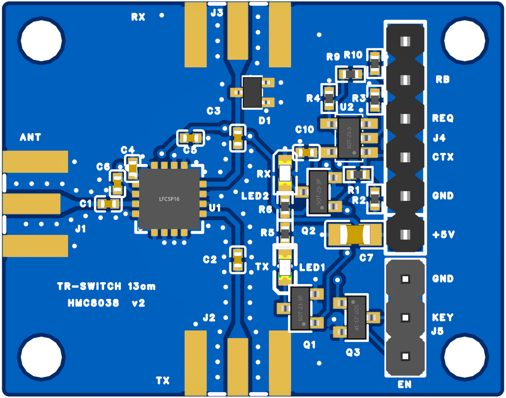

# TR-SWITCH 13 cm — T/R přepínač s HMC8038

[English](README.md) · česky

> **Stav: navrženo, NEOVĚŘENO.** v1 objednaná u JLCPCB 21. 10. 2026 a osazená, ale zatím ani jednou nezměřená.
> Data tady jsou **v2** (opravené zemní pady SMA, viz níže), ta se zatím nevyráběla. Plán měření: report,
> [kap. 4](docs/report.md#4-plán-měření-osazené-desky). Kdo desku postaví a změří dřív, ať se ozve.

Testovací deska přepínače vysílání/příjem pro pásmo 13 cm (2320–2345 MHz):
- **HMC8038** (SPDT, 0,1–6 GHz), porty **ANT / TX / RX** na SMA edge-mount;
- pojistka **AND (74AHCT1G08)**: PA smí klíčovat jen tehdy, když je spínač v TX;
- klíčování PA v obou polaritách (PA_EN „+“, PA_KEY_N „GND“), zpětné čtení PA_EN_RB do C3;
- LED TX/RX ukazují skutečný stav spínače.

Návrh a výpočty: [`docs/report.md`](docs/report.md), zapojení: [`docs/netlist.md`](docs/netlist.md), BOM: [`docs/bom.csv`](docs/bom.csv),
výpočet 50Ω GCPW: [`calc/calc_gcpw.py`](calc/calc_gcpw.py) (numpy, běží asi 8 min), výstup [`calc/gcpw_out.txt`](calc/gcpw_out.txt).

| | |
|---|---|
| deska | **33 × 26 mm**, 4 vrstvy **JLC04161H-7628** (1,6 mm), rohy R0,5, 4× otvor Ø2,7 mm (M2,5) 2,6 mm od rohů |
| RF | 50Ω GCPW **W 0,321 / S 0,254 mm** na TOP nad GND v L2, řady prokovů podél vedení, výřez v L2 pod SMA |
| osazení | vše na TOP, JLC osadí 23 dílů (13 položek). Ručně se pájí SMA J1–J3 (Samtec SMA-J-P-H-ST-EM1) a lišty J4/J5. D1 se neosazuje (DNP) |
| v1 → v2 | v1 má na zemních padech SMA a D1 thermal relief (report, kap. 3, „Verze 2“). v2 je má plnou mědí, jinak je stejná. DRC čisté až na 2 vědomé výjimky |

Schéma: [`vyroba/TR-SWITCH-13CM_schema.png`](vyroba/TR-SWITCH-13CM_schema.png) (v1 i v2 mají stejné).

## Konektory
| | piny |
|---|---|
| **J1 ANT** (levá hrana) | SMA |
| **J3 RX** (horní hrana) | SMA, D1 (BAT15-04W) jako volitelný omezovač |
| **J2 TX** (dolní hrana) | SMA |
| **J4** 1×6 (k C3, pin 1 dole) | 1 +5V, 2 GND, 3 CTRL_TX, 4 PA_REQ, 5 PA_EN_RB, 6 GND |
| **J5** 1×3 (k PA, pin 1 dole) | 1 PA_EN (+5 V = TX), 2 PA_KEY_N (otevřený drain, sepnuto = TX), 3 GND |

Firmware (GPIO, časování t1/t2, pseudokód): report, kap. 1. Ve firmwaru C3 (`cw-beacon`) to zatím není; experimentální firmware S3 (fork ESP-SDR, větev `s3-trx`) CTRL_TX a PA_REQ řídí, ale se spínačem neověřený.

## Objednávka u JLCPCB
- Gerber `vyroba/TR-SWITCH-13CM-v2_Gerber.zip`, 4 vrstvy, **stackup JLC04161H-7628**, 1,6 mm.
- **Prokovy v padu (EP U1): zvolit zaplnění prokovů (epoxy filled & capped)**.
- Osazení: `TR-SWITCH-13CM-v2_BOM_JLC.csv` + `TR-SWITCH-13CM-v2_CPL_JLC.csv`. V náhledu JLC zkontrolovat
  orientaci U1 (pin 1), U2 a polaritu LED1/LED2.
- Impedance ověřena v kalkulačce JLC: pro JLC04161H-7628 vychází W 0,320 mm (na desce 0,321 mm). Vybrat přesně tuto skladbu, ne variantu s písmenem (7628A…).

Navrženo v EasyEDA Pro (projekt `TR-SWITCH-13CM`). Zdrojový projekt EasyEDA ani skripty, které ho generovaly, tu nejsou.

Licence: CERN-OHL-S-2.0 ([`../LICENSE`](../LICENSE)).
