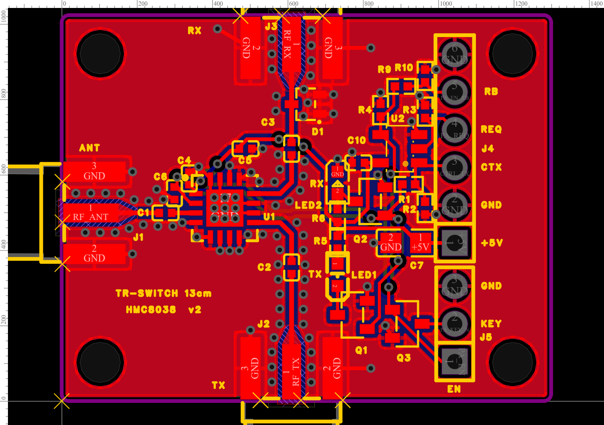

# TR-SWITCH 13 cm — T/R switch with HMC8038

English · [česky](README.cs.md)

> **Status: designed, NOT VERIFIED.** v1 was ordered from JLCPCB on 2026-10-21 and assembled, but has not been measured
> yet. The data here are **v2** (fixed ground pads of the SMA, see below), not manufactured yet. Measurement plan: report,
> [section 4](docs/report.md#4-plán-měření-osazené-desky) (Czech). If you build and measure it first, please report.

Test board of a transmit/receive switch for the 13 cm band (2320–2345 MHz):
- **HMC8038** (SPDT, 0.1–6 GHz), ports **ANT / TX / RX** on edge-mount SMA;
- interlock **AND (74AHCT1G08)**: the PA may key only while the switch is in TX;
- PA keying in both polarities (PA_EN "+", PA_KEY_N "GND"), read-back PA_EN_RB to the C3;
- TX/RX LEDs show the actual state of the switch.

Design and calculations: [`docs/report.md`](docs/report.md) (Czech), connections: [`docs/netlist.md`](docs/netlist.md),
BOM: [`docs/bom.csv`](docs/bom.csv), 50 Ω GCPW calculation: [`calc/calc_gcpw.py`](calc/calc_gcpw.py) (numpy, runs about
8 min), output [`calc/gcpw_out.txt`](calc/gcpw_out.txt).

| | |
|---|---|
| board | **33 × 26 mm**, 4 layers **JLC04161H-7628** (1.6 mm), corners R0.5, 4 holes Ø2.7 mm (M2.5) 2.6 mm from the corners |
| RF | 50 Ω GCPW **W 0.321 / S 0.254 mm** on TOP over GND in L2, via fences along the lines, cut-out in L2 under the SMA |
| assembly | all on TOP, JLC places 23 parts (13 lines). Hand-soldered: SMA J1–J3 (Samtec SMA-J-P-H-ST-EM1) and headers J4/J5. D1 not fitted (DNP) |
| v1 → v2 | v1 has thermal reliefs on the ground pads of the SMA and D1 (report, section 3, "Verze 2"). v2 has solid copper there, otherwise the same. DRC clean except 2 known exceptions |

Schematic: [`vyroba/TR-SWITCH-13CM_schema.png`](vyroba/TR-SWITCH-13CM_schema.png) (same for v1 and v2).

## Connectors
| | pins |
|---|---|
| **J1 ANT** (left edge) | SMA |
| **J3 RX** (top edge) | SMA, D1 (BAT15-04W) as an optional limiter |
| **J2 TX** (bottom edge) | SMA |
| **J4** 1×6 (to the C3, pin 1 at the bottom) | 1 +5V, 2 GND, 3 CTRL_TX, 4 PA_REQ, 5 PA_EN_RB, 6 GND |
| **J5** 1×3 (to the PA, pin 1 at the bottom) | 1 PA_EN (+5 V = TX), 2 PA_KEY_N (open drain, on = TX), 3 GND |

Firmware (GPIOs, timing t1/t2, pseudocode): report, section 1. The C3 firmware (`cw-beacon`) does not drive it yet; the
experimental S3 firmware (ESP-SDR fork, branch `s3-trx`) drives CTRL_TX and PA_REQ, not tried with the switch.

## Ordering from JLCPCB
- Gerber `vyroba/TR-SWITCH-13CM-v2_Gerber.zip`, 4 layers, **stackup JLC04161H-7628**, 1.6 mm.
- **Via in pad (EP of U1): choose epoxy filled & capped vias.**
- Assembly: `TR-SWITCH-13CM-v2_BOM_JLC.csv` + `TR-SWITCH-13CM-v2_CPL_JLC.csv`. In JLC's preview check the rotation of
  U1 (pin 1), U2 and the polarity of LED1/LED2.
- Impedance checked in JLC's calculator: JLC04161H-7628 gives W 0.320 mm (0.321 mm on the board). Choose exactly this
  stackup, not a variant with a letter (7628A…).

Designed in EasyEDA Pro (project `TR-SWITCH-13CM`). The EasyEDA source project and the scripts that generated it are not
included.

Licence: CERN-OHL-S-2.0 ([`../LICENSE`](../LICENSE)).
